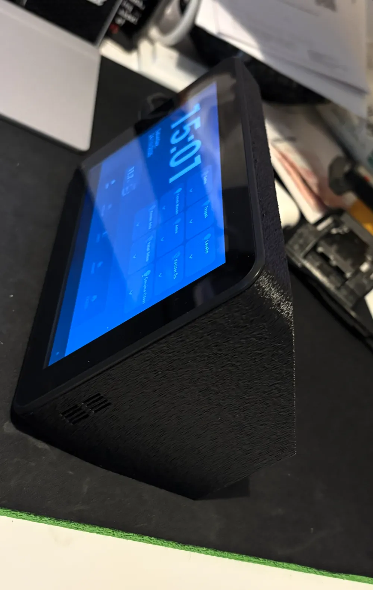
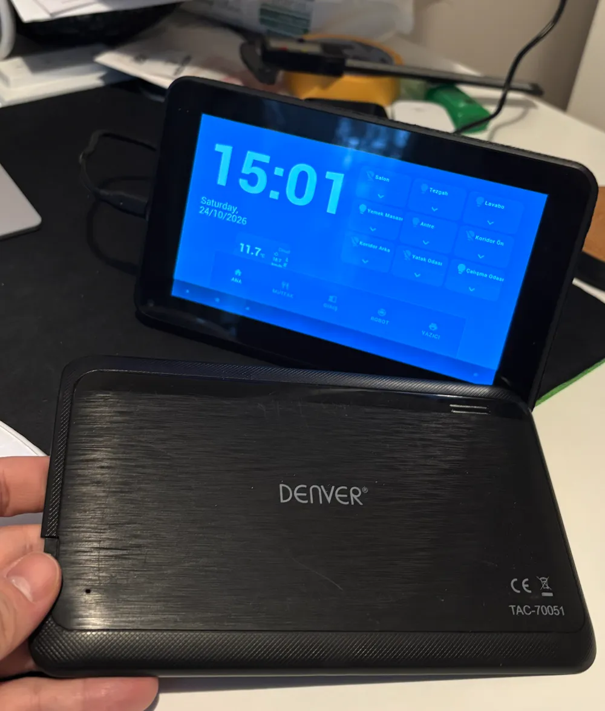

# Denver TAC-70051 Home Assistant Base Station

I turned a 2010s Denver TAC-70051 tablet into a 7-inch Home Assistant control panel. This repository documents the working approach, measured limits, and an example setup. The printable enclosure, assembly photos, and 3D files are on [MakerWorld](https://makerworld.com/en/models/3487173-denver-tac-70051-tablet-homeassistant-base-station#profileId-3982293).

The full build story is on [my blog](https://cagataykilinc.com.tr/2026/10/25/denver-tac-70051-home-assistant-base-station/).

| Dashboard | Enclosure during assembly |
| --- | --- |
|  |  |

More angles, the print profile, and model files are available on [MakerWorld](https://makerworld.com/en/models/3487173-denver-tac-70051-tablet-homeassistant-base-station#profileId-3982293).

## The tablet

| Item | Observed on my unit |
| --- | --- |
| Android | 4.1.1, API 16 |
| SoC | Allwinner A13, single-core Cortex-A8 |
| Usable RAM | About 354 MB |
| Display | 7-inch touch screen, 800 × 480 |
| Firmware family | A13_86V_M758C1 |

The current Home Assistant Android app does not support this Android release. The normal Home Assistant web frontend also stopped at its logo in the tablet's old browser. Changing the URL from a Lovelace view to the Home Assistant root did not fix that JavaScript compatibility issue.

## Working software path

1. Keep the stock Android 4.1.1 firmware. A device-specific modern ROM was not found; generic Allwinner A13 images risk breaking touch, Wi-Fi, or boot.
2. Install [WallPanel Legacy](https://github.com/thanksmister/wallpanel-android-legacy), version 0.8.4 build 7 in this build, as the full-screen browser. It bundles an older Crosswalk engine compatible with Android 4.1.
3. Run [HoaryDash](https://github.com/Skrubbadubba/HoaryDash) alongside Home Assistant. This build used HoaryDash 0.13.0. Point WallPanel to the HoaryDash dashboard on the trusted local network.
4. Keep the page light: 800 × 480 layout, large touch targets, system fonts, minimal animation, and a small number of controls per tab.

My dashboard has a large clock, centered two-line Turkish date, Turkish weather labels, lights grouped by room, robot vacuum actions, and printer controls. After inactivity or screen dimming it returns to the Home tab. An ES5-compatible script was needed for the old browser.

A [shareable HoaryDash YAML layout](examples/hoarydash.example.yaml), [example Home Assistant scripts](examples/home-assistant-scripts.example.yaml), and [setup notes](docs/dashboard-example.md) model the five tabs and robot controls. Replace every example entity with your own Home Assistant entities. The encrypted backup on this computer does not expose the live HoaryDash YAML, so this is a rebuilt example rather than the exact running configuration.

## Enclosure and wiring

The [MakerWorld model](https://makerworld.com/en/models/3487173-denver-tac-70051-tablet-homeassistant-base-station#profileId-3982293) is a landscape base with a rear opening for a 5 V USB-C power module, a top opening for a momentary button, and side speaker slots. The button is wired in parallel with the tablet's original power switch. The USB-C module feeds the **original Micro-USB 5 V input**, not the battery terminals, so the tablet's charge circuit stays in use. Verify VBUS, ground, voltage, polarity, and the board's USB-C CC resistors for your actual module before connecting anything.

The linked MakerWorld page contains the print files, photos, measurements, print suggestions, and the full assembly guide. This repository deliberately links to that source instead of mirroring its 3D files under a different license.

## Experiments and findings

- Reversibly disabling five unused Google apps (Maps, Gmail, Search, Talk, photo uploader) raised one sampled free-memory reading from about 30 MB to 48 MB. This is a snapshot, not a speed benchmark. Keep package changes reversible and test Wi-Fi, touch, keyboard, and WallPanel after each batch.
- The display is mounted in reverse landscape. A settings-only rotation initially changed the reported value without correctly aligning touch. The final SurfaceFlinger orientation and touch mapping were verified together.
- WallPanel camera motion detection can brighten the screen when someone approaches. It must remain on the dashboard; opening its settings can stop the foreground camera service until returning to the dashboard.
- The tablet entered deep sleep when removed from USB, interrupting camera-based wake. Keeping Android awake solved that behavior, but keeps the CPU and camera busy.
- A root helper turns the **backlight** down to zero after about 30 seconds and restores it on motion. On this kernel, tests of `brightness=0`, `fb0/blank`, and the LCD off command did not remove the visible LCD image layer while the camera stayed active. Backlight off is not full display or system sleep.
- WallPanel and the camera were observed using roughly 67–70% CPU. For a genuinely low-power battery setup, a separate PIR/mmWave sensor that wakes a sleeping tablet through the power-button circuit is a more promising architecture; it is not implemented here.
- My six 1750 mAh 18650 cells are connected in parallel (nominal 10,500 mAh for a 1S6P pack). I changed the firmware's design-capacity field from 2,600 to 10,000 mAh and capped wake brightness at 191/255 (75%). The capacity edit changes reported battery design capacity; it does **not** increase actual energy or prove the percentage gauge is accurate. No battery runtime measurement is published.

## Hardware notes

The camera/CPU workload and an always-powered old lithium battery need temperature and battery-condition monitoring. Use matched, protected cells and an appropriate 1S protection and charging arrangement. Never connect USB 5 V directly to a single-cell lithium battery. The MakerWorld assembly guide gives more hardware details.

## Sources

- [Enclosure, photos, print files, assembly guide](https://makerworld.com/en/models/3487173-denver-tac-70051-tablet-homeassistant-base-station#profileId-3982293)
- [WallPanel Legacy](https://github.com/thanksmister/wallpanel-android-legacy)
- [HoaryDash](https://github.com/Skrubbadubba/HoaryDash)
- [Home Assistant Android app requirements](https://companion.home-assistant.io/docs/getting_started/)
- [Home Assistant frontend browser targets](https://github.com/home-assistant/frontend/blob/dev/.browserslistrc)

## Project scope

This is a documented one-device build, not a universal firmware image or a ready-to-flash ROM. Hardware revisions and Home Assistant entity IDs vary. The live configuration, local addresses, credentials, and boot partition backups are intentionally excluded.
