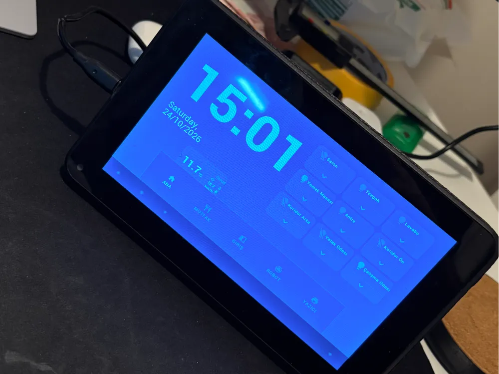
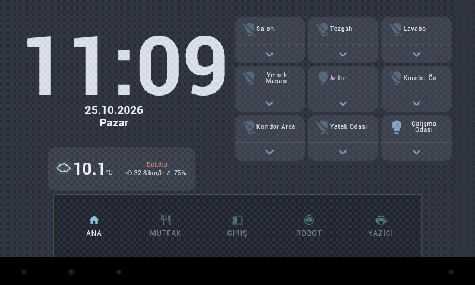
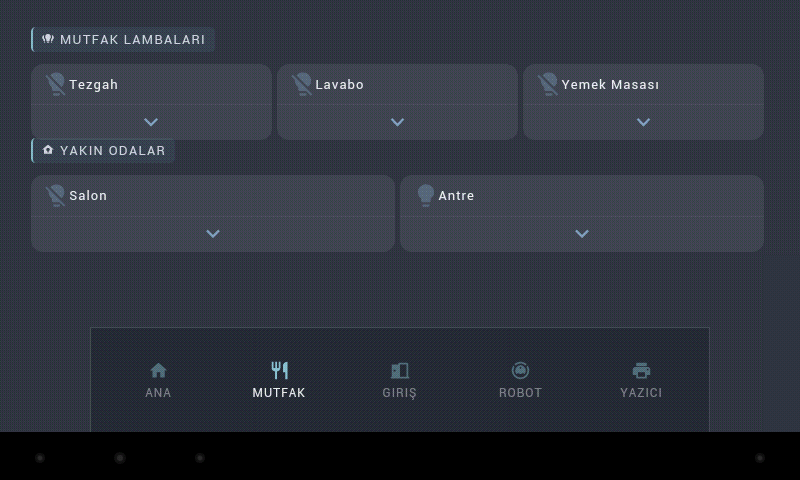
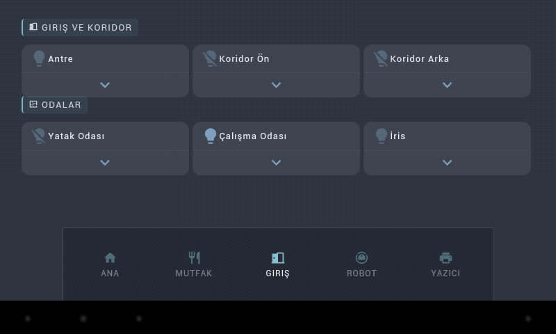
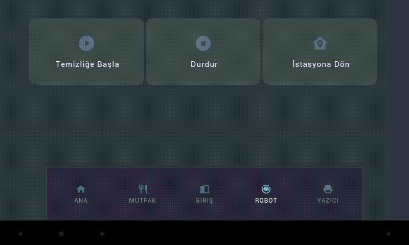
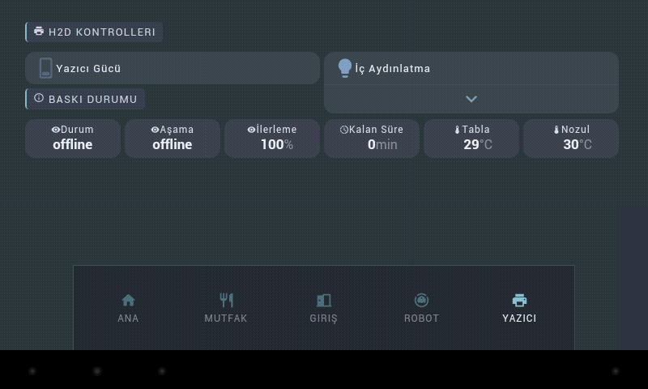

# Denver TAC-70051 Home Assistant Base Station

This project gives a Denver TAC-70051 tablet a second life as a 7-inch Home Assistant control panel. It documents the working software stack, the custom 800 × 480 dashboard, the root-only backlight and reliability helpers, battery-gauge calibration, and the printable enclosure.

The enclosure, print profile, and assembly guide are on [MakerWorld](https://makerworld.com/en/models/3487173-denver-tac-70051-tablet-homeassistant-base-station#profileId-3982293). The complete build story is on [my blog](https://cagataykilinc.com.tr/2026/10/25/denver-tac-70051-home-assistant-base-station/).

## What works

- Stock Android 4.1.1 with [WallPanel Legacy](https://github.com/thanksmister/wallpanel-android-legacy) 0.8.4 build 7.
- [HoaryDash](https://github.com/Skrubbadubba/HoaryDash) 0.13.0 as a Chromium 44-compatible Home Assistant frontend.
- Large clock, centered two-line Turkish date, translated weather conditions, and room lighting controls.
- Separate Kitchen, Entrance, Robot Vacuum, and Bambu Lab printer pages.
- Automatic return to the Home page after inactivity.
- Front-camera motion detection that restores the backlight to a capped 75% level.
- Root helper that turns the hardware backlight fully off while Android and the camera remain awake.
- Boot launcher and watchdog that recover WallPanel after a low-memory kill or gradual Crosswalk memory growth.
- Optional Allwinner firmware capacity calibration for a properly protected 1S parallel battery pack.

## The tablet

| Item | Observed on this unit |
| --- | --- |
| Android | 4.1.1, API 16 |
| SoC | Allwinner A13 / sun5i, single-core Cortex-A8 |
| Usable RAM | About 354 MB |
| Display | 7-inch touch screen, 800 × 480 |
| Firmware family | A13_86V_M758C1 |

The current Home Assistant Android app does not support this Android version. The normal Home Assistant frontend also stops during loading in the tablet's old browser. Changing from a Lovelace URL to the Home Assistant root does not solve that JavaScript compatibility problem. HoaryDash renders the dashboard server-side for old Chromium versions and is the reliable path used here.

## Dashboard screenshots

These are direct 800 × 480 screenshots captured from the tablet, not desktop mock-ups.

| Home | Kitchen |
| --- | --- |
|  |  |

| Entrance | Robot vacuum |
| --- | --- |
|  |  |

## Quick start

1. Keep the stock device-specific firmware unless you have a verified TAC-70051 image. Generic Allwinner A13 images can break touch, Wi-Fi, camera, or boot.
2. Install WallPanel Legacy and configure it using [the tested settings](docs/wallpanel-settings.md).
3. Install the HoaryDash Home Assistant add-on and expose its port only to your trusted LAN.
4. Copy [`examples/hoarydash.example.yaml`](examples/hoarydash.example.yaml) to the HoaryDash add-on configuration directory as `hoarydash.yaml`.
5. Copy the example template sensor and vacuum scripts into Home Assistant, then replace every `example_*` entity with your own entity IDs.
6. Set WallPanel's start URL to `http://HOME_ASSISTANT_HOST:4567/dash/`.
7. Test every control on the tablet before enabling start-on-boot or root modifications.

The YAML contains the actual layout strategy and old-browser fixes used by the running panel, with device-specific entity IDs replaced by descriptive placeholders. It contains no Home Assistant token, Wi-Fi credential, local computer path, ADB serial, or public host name.

## Root enhancements

The basic dashboard does not require root. Root is only needed for the low-level backlight helper, boot script, and watchdog in [`android/`](android/README.md).

The camera cannot detect motion while Android is in real suspend. The practical compromise is to keep Android, WallPanel, and the front camera awake while setting the Allwinner hardware backlight to zero. On this kernel the LCD image layer may remain faintly visible under strong ambient light even though the backlight is off. This is not deep sleep and the camera/Crosswalk workload still consumes power.

The watchdog addresses a second limitation: Crosswalk was observed growing beyond roughly 200 MB on a tablet with only about 354 MB usable RAM. Android can kill the activity and leave the launcher visible while WallPanel's service restarts. The watchdog brings the activity back and can recycle it while the panel is dark.

## Battery notes

This build uses six similar 1750 mAh 18650 cells in a protected **1S6P** pack: 10,500 mAh nominal. The firmware design-capacity value was changed from 2,600 to 10,000 mAh so Android's reporting model is closer to the installed pack. This does not create energy, increase charge current, validate the cells, or guarantee an accurate percentage.

Read [`docs/battery-capacity.md`](docs/battery-capacity.md) before changing `script.bin`. Never connect USB 5 V directly to a single-cell lithium battery. Use an appropriate 1S BMS/protection arrangement, matched cells, correct fusing, and the tablet's original charging input. With the observed 600 mA charge setting, a pack of this size can take many hours to charge while the tablet is operating.

## Enclosure and wiring

The [MakerWorld model](https://makerworld.com/en/models/3487173-denver-tac-70051-tablet-homeassistant-base-station#profileId-3982293) is a landscape base with:

- a rear opening for a 5 V USB-C power module;
- a top momentary switch wired in parallel with the original power button;
- side openings for the tablet speaker;
- clearance for the modified battery and internal wiring.

The USB-C module feeds the tablet's **original Micro-USB 5 V input**, not the battery terminals, so the tablet's charger remains in the circuit. Verify the module's VBUS, ground, polarity, USB-C CC resistors, and output under load before connecting it.

## Repository map

- [`examples/hoarydash.example.yaml`](examples/hoarydash.example.yaml) — reproducible five-page dashboard with responsive CSS and ES5 JavaScript.
- [`examples/home-assistant-template.example.yaml`](examples/home-assistant-template.example.yaml) — Turkish two-line date sensor.
- [`examples/home-assistant-scripts.example.yaml`](examples/home-assistant-scripts.example.yaml) — vacuum start, stop, and dock scripts.
- [`docs/dashboard-example.md`](docs/dashboard-example.md) — entity mapping and dashboard installation guide.
- [`docs/wallpanel-settings.md`](docs/wallpanel-settings.md) — tested WallPanel Legacy camera, motion, browser, and power settings.
- [`android/`](android/README.md) — source and installation notes for the rooted-tablet helpers.
- [`docs/battery-capacity.md`](docs/battery-capacity.md) — safe workflow for changing the reported pack capacity.

## Measured limitations

- WallPanel plus camera motion detection was observed using roughly 67–70% CPU.
- Backlight-off saves display power but is not full LCD power-down or Android suspend.
- Camera motion wake depends on WallPanel staying in the foreground; opening settings can pause its camera service until the dashboard is shown again.
- Browser auto-refresh caused a persistent loading spinner in this setup and is intentionally disabled.
- The root helpers and Allwinner display ioctl values are specific to this firmware family. Do not install them blindly on another tablet.
- A separate PIR/mmWave sensor wired to the power-button circuit would allow real system sleep and should be more efficient, but it is not implemented in this repository.

## Privacy and scope

This repository intentionally excludes live credentials, access tokens, Wi-Fi data, private network addresses, computer usernames and paths, ADB serial numbers, Home Assistant backups, and raw boot-partition images. Entity IDs in the examples are placeholders. The project documents one verified device build; it is not a universal firmware image or a ready-to-flash ROM.

## Upstream projects

- [WallPanel Legacy](https://github.com/thanksmister/wallpanel-android-legacy)
- [HoaryDash](https://github.com/Skrubbadubba/HoaryDash)
- [Home Assistant vacuum integration](https://www.home-assistant.io/integrations/vacuum/)
- [linux-sunxi tools](https://github.com/linux-sunxi/sunxi-tools)
