# Home Assistant Legacy Panels

Lightweight Home Assistant touch dashboards for older Android tablets and phones.
Separate device profiles keep shared interface code reusable while preserving
hardware-specific behavior. The project started on a Denver TAC-70051 and now
also includes a Samsung SM-J510FN office panel.

**Project renamed:** previously `denver-tac-70051-home-assistant-base-station`.
Denver remains a supported reference profile; its printable enclosure is specific
to that tablet. This repository contains dashboards, configuration examples and
guides. The separate [WallPanel Legacy Lite fork](https://github.com/kilinccagatay/wallpanel-android-legacy/tree/lite-motion-core)
contains APK and Android/root-helper sources.

## Device profiles

| | Denver home panel | Samsung office panel |
| --- | --- | --- |
| Reference hardware | TAC-70051, Android 4.1.1 / API 16, 800 × 480 | SM-J510FN, Android 6 / API 23, landscape |
| Home controls | Eight household-lighting / vacuum controls | Office light, Bambu Lab H2D summary, agenda and forecast |
| Other views | Kitchen, Entrance, Rooms, Robot | Lights grouped by area; dedicated Printer view |
| Battery overlay | Native battery/charging badge; long press opens Android controls | Hidden for this batteryless installation |
| Meeting data | Fresh boolean badge only; no meeting titles | Optional selected-calendar titles and start/end times |
| Hardware tuning | Allwinner-specific backlight gate and motion profile | Separate flavor/configuration; navigation lock is reversible |

**Status:** the expanded office implementation is on
[`codex/office-workday-panel`](https://github.com/kilinccagatay/home-assistant-legacy-panels/tree/codex/office-workday-panel)
and [draft PR #1](https://github.com/kilinccagatay/home-assistant-legacy-panels/pull/1).
Individual controls and layouts have installed-device evidence; the full general
regression gate has not passed. The Samsung display/wake baseline remains an
open issue. This is experimental software, not a fully accepted hardware release.

## Features at a glance

- **Lightweight frontend:** HoaryDash, ES5 JavaScript, no application framework;
  designed for old Chromium/Crosswalk rather than the current Lovelace frontend.
- **Readable overview:** large clock, centered two-line Turkish date, translated
  weather, indoor temperature and humidity from explicitly mapped sensors.
- **Lighting:** tap to toggle; long press for supported brightness, color and
  temperature controls; immediate touch sound, synchronized state and per-lamp
  default tones. Corridor and kitchen groups have explicit lighting targets.
- **Home actions:** robot start/return-to-dock and a cancellable 60-second
  household-lights-off countdown. Printer/server power is excluded.
- **Office agenda:** two upcoming work events (three when space permits),
  weekend-to-Monday selection, and explicit stale/disconnected states.
- **Office forecast:** five days beginning **today**, colored SVG symbols and
  daily high/low temperatures. Uses the existing HA weather source; missing days
  show an em dash. Refreshes every 30 minutes while the home view is visible.
- **Printer overview:** status accents, active-print percentage and progress,
  remaining time, nozzle/bed readings, grouped AMS-HT / AMS 2 Pro filament slots,
  and visible empty slots. Camera requests stop outside its view or when offline.
- **Printer power:** double tap, explicit power-off confirmation, and an additional
  acknowledgement when a print is active. Targets an existing configured switch.
- **Device isolation:** office-only calendar/forecast data, separate preferences,
  no Samsung battery overlay, and hardware-specific Android behavior kept apart.
- **Acceptance discipline:** rollback/settings preservation and a
  [mandatory regression checklist](docs/regression-checklist.md), including
  balanced padding, optical alignment and selected/unselected-state review.

## Start here

- [Panel V2 setup and entity mapping](docs/panel-v2.md)
- [Office profile and printer/calendar/forecast guide](https://github.com/kilinccagatay/home-assistant-legacy-panels/blob/codex/office-workday-panel/docs/office-profile.md)
- [Older-hardware Android setup and tuning](https://github.com/kilinccagatay/wallpanel-android-legacy/blob/lite-motion-core/docs/legacy-hardware-guide.md)
- [Mac Call Indicator companion](https://github.com/kilinccagatay/mac-call-indicator)
- [Denver enclosure on MakerWorld](https://makerworld.com/en/models/3487173-denver-tac-70051-tablet-homeassistant-base-station#profileId-3982293)

The household entity mapping is private. Replace all example entities with your
own. Never copy one device's root/display commands onto another model.

## Office preview

This is a direct 1280 × 720 capture from the Samsung SM-J510FN. Only the meeting-title area was covered for privacy and marked “Toplantı adı gizlendi”; other displayed values and controls are unchanged. The original unredacted image is not published.
The forecast below is cropped from the same device and contains no calendar data:

## Denver reference build

Stock Android 4.1.1 / API 16; Allwinner A13 (single-core Cortex-A8); about
354 MB usable RAM; 7-inch 800 × 480 display. The normal Home Assistant frontend
cannot run reliably in its old browser. HoaryDash is the compatibility frontend.

The tested charger-powered profile keeps Android, the LCD image and camera alive
while switching the separate backlight-enable gate off. Brightness zero alone
left shimmer on this unit. The reference settings are 3 FPS / 333 ms, a 30-second
idle timeout, 75% wake brightness and a locally tuned threshold of 5. These are
Denver observations, not universal Samsung settings or battery-life guarantees.

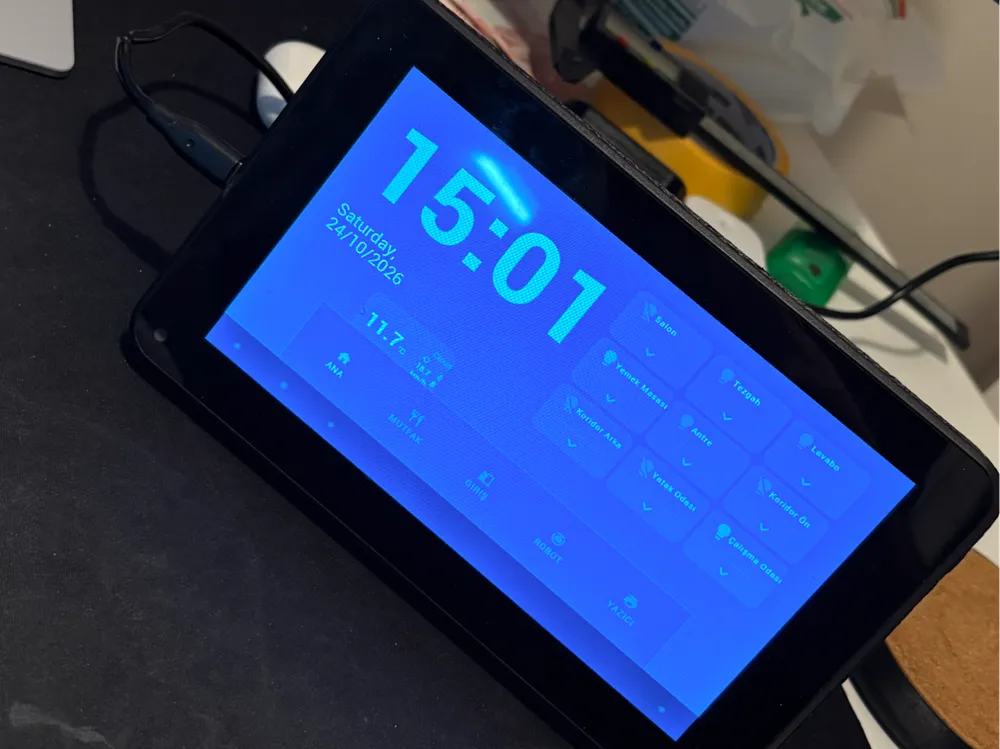

The original [build story](https://cagataykilinc.com.tr/2026/10/25/denver-tac-70051-home-assistant-base-station/)
and enclosure remain useful historical references.

## Updated touch controls

The optional [Panel V2 guide](docs/panel-v2.md) adds eight Home controls, a larger
weather readout, long-press brightness/color dialogs, grouped corridor control,
robot return-to-base, and a server-side 60-second household-lights-off countdown
with cancellation on its Home button. Kitchen toggles only counter/sink lights;
large circular color presets and an optional quiet click improve touch controls.
A common clock/weather column appears on Home, Kitchen, Entrance, Rooms, and Robot;
a lower-left settings icon opens sound, hold timing, cleaning lock, and reload.
Live brightness/color stays synchronized in reused dialogs; presets close after a
successful command. Configurable per-lamp default color profiles restore each
lamp’s own normal tone on the next panel turn-on, preserving brightness.
The guide includes current V2 browser captures and optional tab removal. Native
battery long press and display helpers remain unchanged.

## Dashboard screenshots

The Denver Panel V2 interface is shown below. These are **800 × 480 browser
captures of the deployed dashboard with live Home Assistant data**. WallPanel’s
native battery badge is drawn by Android and is therefore absent from these images.

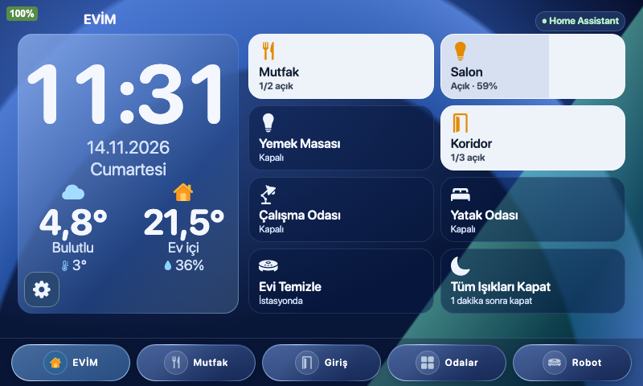

| Kitchen | Entrance |
| --- | --- |
| 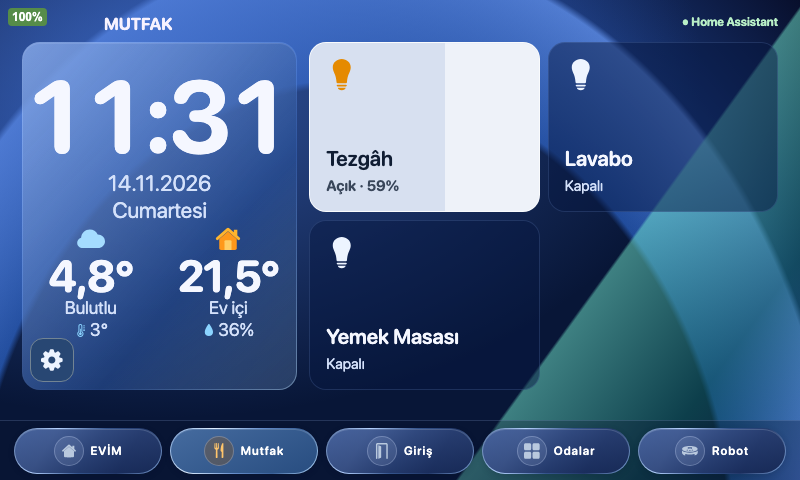 | 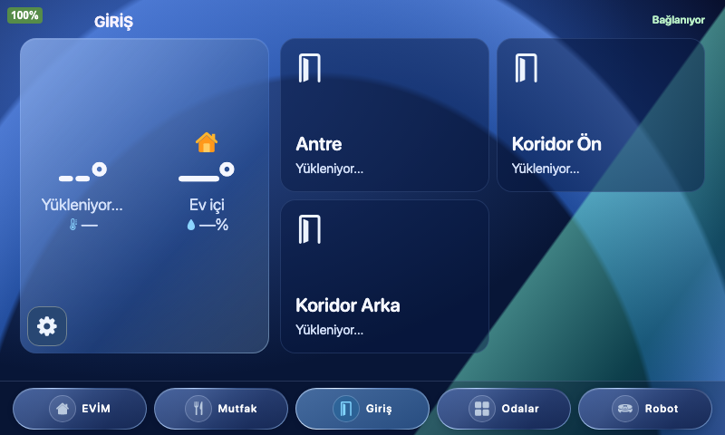 |

| Rooms | Robot vacuum |
| --- | --- |
| 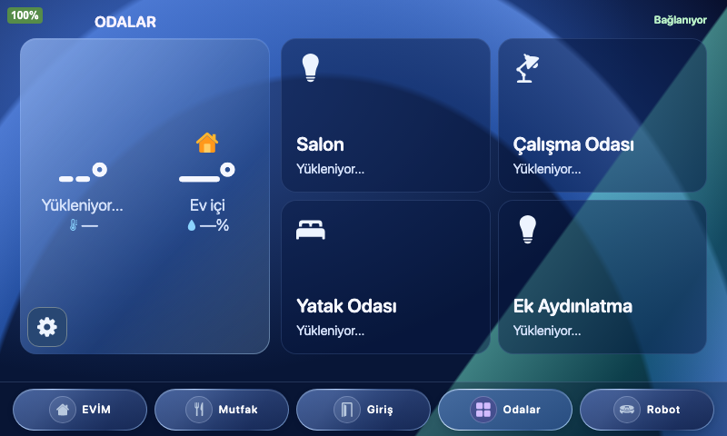 | 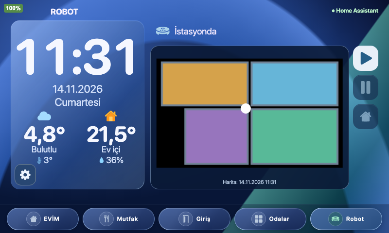 |

| Brightness and color presets | Panel settings |
| --- | --- |
| 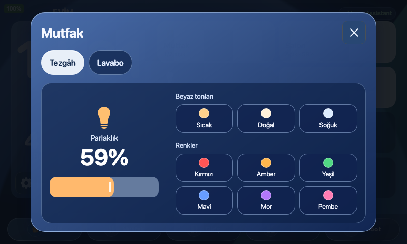 | 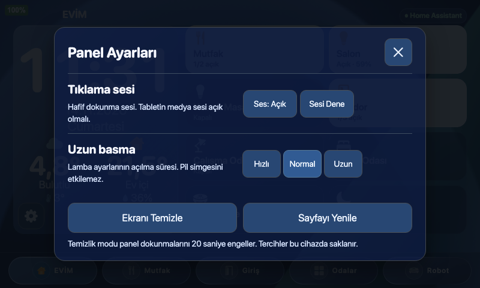 |

### Samsung office panel — live printer view

Actual **1280 × 720 Samsung device capture** during an H2D print: camera image,
print progress, remaining time, nozzle/bed temperatures, and grouped AMS slots.
AMS-HT is on the left; the active filament uses a rounded highlight with space
around its color swatch and labels.

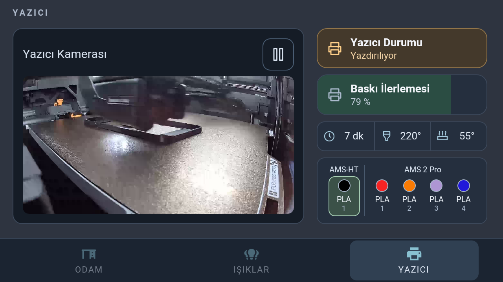

See the [office profile guide](docs/office-profile.md#printer-camera-view) for
camera prerequisites and printer controls.

See the [Panel V2 guide](docs/panel-v2.md) for interaction behavior, configuration,
and installation.

Earlier interface — screenshots from the physical tablet

These direct tablet captures document the previous layout, including its printer
page. The current five-tab Panel V2 layout appears in the gallery above.

| Home | Kitchen |
| --- | --- |
| 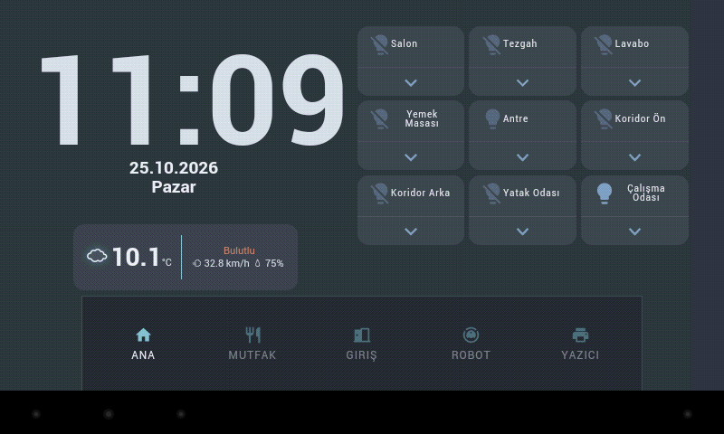 | 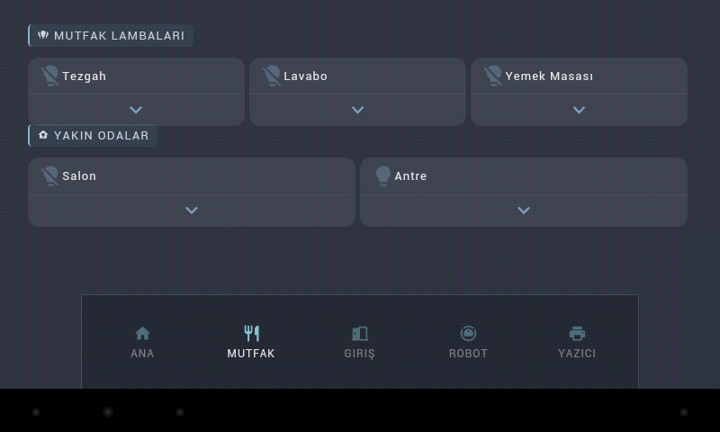 |

| Entrance | Robot vacuum |
| --- | --- |
| 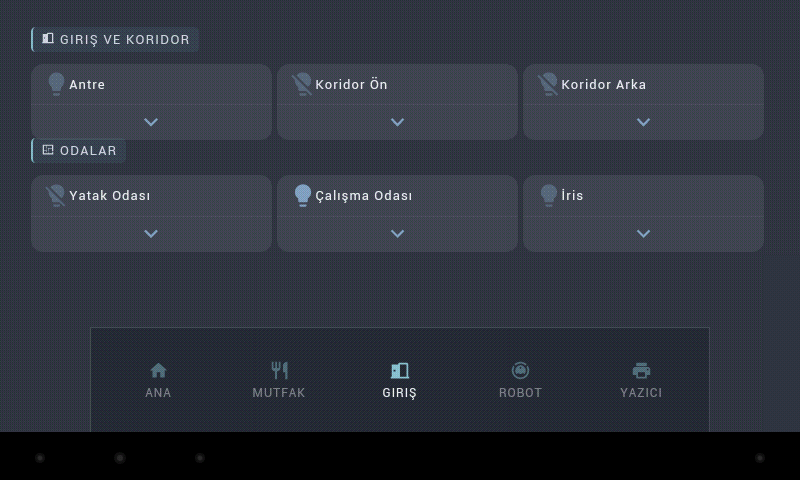 | 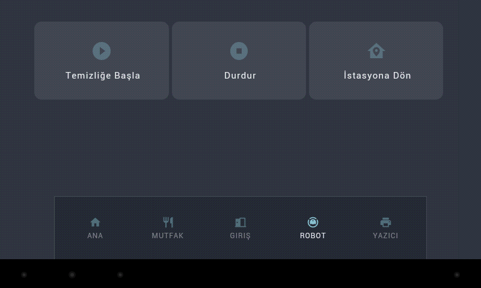 |

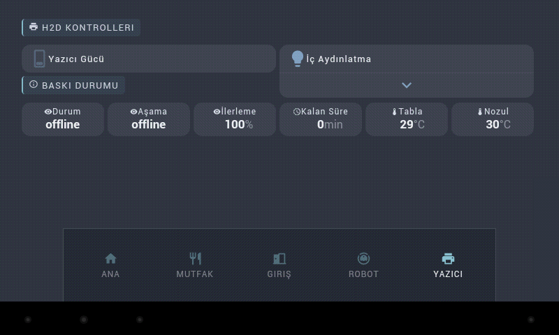

## Mac call indicator

[Mac Call Indicator](https://github.com/kilinccagatay/mac-call-indicator) is a
separate macOS menu-bar companion. It reads Teams call controls locally through
Accessibility and sends only `in_call: true/false` to Home Assistant. General
Busy status alone does not trigger it. No meeting title, participant, phone
number, Graph permission, or Entra registration is needed.

The small **Toplantı** badge appears only on **Evim** (internal `Ana` route).
In Panel V2 it sits below the weather in the left column, clear of navigation. Missing heartbeats expire
the state after 40 seconds, and the browser also hides stale/disconnected data.
The Mac menu provides **Start at Login**; no tablet APK or firmware change is
needed for this integration.

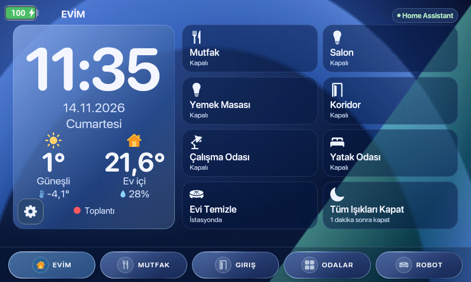

This is a direct capture from the tablet running Build 8 during an active meeting,
including its native battery badge. Only the orientation was rotated 180° to match
the mounted tablet; no meeting name, participant, or company content is shown.

Follow the [integration guide](docs/mac-call-indicator.md). The full dashboard
example includes the optional badge; without the companion entity it stays
hidden. The helper is experimental and has been validated with Teams test calls;
it is not a universal macOS or phone-call detector.

## Quick start

1. Keep the stock device-specific firmware unless you have a verified TAC-70051 image. Generic Allwinner A13 images can break touch, Wi-Fi, camera, or boot.
2. Install WallPanel Legacy and configure it using [the tested settings](docs/wallpanel-settings.md).
3. Install the HoaryDash Home Assistant add-on and expose its port only to your trusted LAN.
4. Copy [`examples/hoarydash.example.yaml`](examples/hoarydash.example.yaml) to the HoaryDash add-on configuration directory as `hoarydash.yaml`.
5. Copy the example template sensor and vacuum scripts into Home Assistant, then replace every `example_*` entity with your own entity IDs.
6. Set WallPanel's start URL to `http://HOME_ASSISTANT_HOST:4567/dash/`.
7. Test every control on the tablet before enabling start-on-boot or root modifications.

The YAML contains the actual layout strategy and old-browser fixes used by the running panel, with device-specific entity IDs replaced by descriptive placeholders. It contains no Home Assistant token, Wi-Fi credential, local computer path, ADB serial, or public host name.

## Root enhancements

The basic dashboard does not require root. Current low-level display, power-button, kiosk, and recovery sources live in the [fork's `device-root/` directory](https://github.com/kilinccagatay/wallpanel-android-legacy/tree/lite-motion-core/device-root). This repository's [`android/`](android/README.md) files are an earlier backlight-only snapshot; do not combine them with the current APK.

For automatic recovery from HoaryDash startup HTTP 404 errors, see the [bounded server and Denver browser recovery guide](docs/hoarydash-recovery.md).

On the tested Denver kernel, real Android screen-off interrupted camera frames. The current continuously powered profile keeps Android, WallPanel, the LCD image, and the front camera active while closing only the backlight-enable gate on verified AXP20 GPIO1. Brightness/PWM zero alone left a low-light shimmer; the separate enable gate produced a user-confirmed stable dark state. An image visible under external light is expected. The previous LCD-off behavior remains selectable; see [display profiles](https://github.com/kilinccagatay/wallpanel-android-legacy/blob/lite-motion-core/device-root/display-profiles.md). Neither mode proves system sleep. Camera and browser processing still consume power.

The watchdog addresses a second limitation: Crosswalk was observed growing beyond roughly 200 MB on a tablet with only about 354 MB usable RAM. Android can kill the activity and leave the launcher visible while WallPanel's service restarts. The watchdog brings the activity back and can recycle it while the panel is dark.

## Battery notes

The tablet now uses its original battery and is intended for continuous charger power. An earlier experiment used six 1750 mAh cells in parallel and a 10,000 mAh firmware design-capacity value. That experiment is historical, not the current build or a recommendation for other tablets. The current firmware capacity value must be checked independently; reconnecting the original battery does not automatically restore that field.

Read [`docs/battery-capacity.md`](docs/battery-capacity.md) before changing `script.bin`. Never connect USB 5 V directly to a single-cell lithium battery. Use an appropriate 1S BMS/protection arrangement, matched cells, correct fusing, and the tablet's original charging input. With the observed 600 mA charge setting, a pack of this size can take many hours to charge while the tablet is operating.

## Enclosure and wiring

The [MakerWorld model](https://makerworld.com/en/models/3487173-denver-tac-70051-tablet-homeassistant-base-station#profileId-3982293) is a landscape base with:

- a rear opening for a 5 V USB-C power module;
- a top momentary switch wired in parallel with the original power button;
- side openings for the tablet speaker;
- clearance for the modified battery and internal wiring.

The USB-C module feeds the tablet's **original Micro-USB 5 V input**, not the battery terminals, so the tablet's charger remains in the circuit. Verify the module's VBUS, ground, polarity, USB-C CC resistors, and output under load before connecting it.

## Repository map

- [`examples/hoarydash.example.yaml`](examples/hoarydash.example.yaml) — reproducible five-page dashboard with responsive CSS and ES5 JavaScript.
- [`examples/home-assistant-template.example.yaml`](examples/home-assistant-template.example.yaml) — Turkish two-line date sensor.
- [`examples/home-assistant-scripts.example.yaml`](examples/home-assistant-scripts.example.yaml) — vacuum start, stop, and dock scripts.
- [`docs/dashboard-example.md`](docs/dashboard-example.md) — entity mapping and dashboard installation guide.
- [`docs/wallpanel-settings.md`](docs/wallpanel-settings.md) — tested WallPanel Legacy camera, motion, browser, and power settings.
- [`android/`](android/README.md) — source and installation notes for the rooted-tablet helpers.
- [`docs/battery-capacity.md`](docs/battery-capacity.md) — safe workflow for changing the reported pack capacity.

## Measured limitations

- The original build showed roughly 67–70% CPU. After the Lite runtime and sampled detector, short 3 FPS snapshots showed WallPanel around 5%. These are different sessions, not a controlled benchmark or battery-life claim.
- LCD-off driver commands do not establish Android suspend or measure every display power rail.
- Camera motion wake depends on WallPanel staying in the foreground; opening settings can pause its camera service until the dashboard is shown again.
- Browser auto-refresh caused a persistent loading spinner in this setup and is intentionally disabled.
- The root helpers and Allwinner display ioctl values are specific to this firmware family. Do not install them blindly on another tablet.
- Camera sensitivity depends on light and noise. Threshold 6 improved a user dim-room test; 5 is the latest local setting and needs further false-wake testing.
- A 4 FPS / 250 ms experiment with direct display triggers was reverted after wake failures. Use the stable 3 FPS / 333 ms APK and matching helpers.

## Privacy and scope

This repository intentionally excludes live credentials, access tokens, Wi-Fi data, private network addresses, computer usernames and paths, ADB serial numbers, Home Assistant backups, and raw boot-partition images. Entity IDs in the examples are placeholders. The project documents separate device profiles and their observed limits; it is not a universal firmware image or a ready-to-flash ROM.

## Upstream projects

- [WallPanel Legacy](https://github.com/thanksmister/wallpanel-android-legacy)
- [HoaryDash](https://github.com/Skrubbadubba/HoaryDash)
- [Home Assistant vacuum integration](https://www.home-assistant.io/integrations/vacuum/)
- [linux-sunxi tools](https://github.com/linux-sunxi/sunxi-tools)

Recent dashboard guides: [three-workday calendar](docs/office-profile.md#three-workday-agenda-selection) ·
[outside apparent temperature](docs/outdoor-feels-like.md) ·
[SMHI weather setup](docs/smhi-weather.md) ·
[scoped validation and pending device checks](docs/three-day-agenda-review.md).
