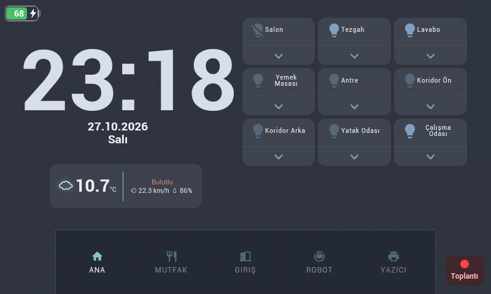

# Home Assistant panels on older Android hardware — Denver-tested build

This project documents a Home Assistant panel for older Android hardware with limited CPU power, RAM, and browser support. The reference build is a Denver TAC-70051 with Android 4.1.1 and an 800 × 480 screen. Dashboard layout and application tuning can inform other tablets; the printable enclosure and Allwinner root modifications remain specific to this device. Other hardware has not been verified.

Start with the [older-hardware setup and tuning guide](https://github.com/kilinccagatay/wallpanel-android-legacy/blob/lite-motion-core/docs/legacy-hardware-guide.md). This repository supplies the dashboard, screenshots, and physical-build examples; the [WallPanel Lite fork](https://github.com/kilinccagatay/wallpanel-android-legacy/tree/lite-motion-core) is the maintained source for the current APK and root helpers.

The enclosure, print profile, and assembly guide are on [MakerWorld](https://makerworld.com/en/models/3487173-denver-tac-70051-tablet-homeassistant-base-station#profileId-3982293). The complete build story is on [my blog](https://cagataykilinc.com.tr/2026/10/25/denver-tac-70051-home-assistant-base-station/).

## What works

- Stock Android 4.1.1 with the custom WallPanel Legacy Lite fork from `lite-motion-core`. Upstream 0.8.4 build 7 was the initial installation.
- [HoaryDash](https://github.com/Skrubbadubba/HoaryDash) 0.13.0 as a Chromium 44-compatible Home Assistant frontend.
- Large clock, centered two-line Turkish date, translated weather conditions, and room lighting controls.
- Separate Kitchen, Entrance, Robot Vacuum, and Bambu Lab printer pages.
- Automatic return to the Home page after inactivity.
- Optional Mac Teams call badge on Home, with a larger red dot above a centered label and no navigation overlap.
- Front-camera motion detection that restores the backlight to a capped 75% level.
- Charger-powered backlight-only profile: the LCD image, Android, and camera stay active while the separate backlight-enable gate is closed. Brightness zero alone was insufficient on this unit; the earlier LCD-off profile is retained for rollback.
- Boot launcher and watchdog that recover WallPanel after a low-memory kill or gradual Crosswalk memory growth.
- Camera profile: 3 FPS / 333 ms, 30-second inactivity dimming, 75% wake brightness, and a locally tuned motion difference threshold of 5.

## The tablet

| Item | Observed on this unit |
| --- | --- |
| Android | 4.1.1, API 16 |
| SoC | Allwinner A13 / sun5i, single-core Cortex-A8 |
| Usable RAM | About 354 MB |
| Display | 7-inch touch screen, 800 × 480 |
| Firmware family | A13_86V_M758C1 |

The current Home Assistant Android app does not support this Android version. The normal Home Assistant frontend also stops during loading in the tablet's old browser. Changing from a Lovelace URL to the Home Assistant root does not solve that JavaScript compatibility problem. HoaryDash renders the dashboard server-side for old Chromium versions and is the reliable path used here.

## Dashboard screenshots

These are direct 800 × 480 screenshots captured from the tablet, not desktop mock-ups.

| Home | Kitchen |
| --- | --- |
|  |  |

| Entrance | Robot vacuum |
| --- | --- |
|  |  |

## Mac call indicator

[Mac Call Indicator](https://github.com/kilinccagatay/mac-call-indicator) is a
separate macOS menu-bar companion. It reads Teams call controls locally through
Accessibility and sends only `in_call: true/false` to Home Assistant. General
Busy status alone does not trigger it. No meeting title, participant, phone
number, Graph permission, or Entra registration is needed.

The small **Toplantı** badge appears only on Ana (Home). Its red dot sits above
the centered label, clear of the bottom navigation. Missing heartbeats expire
the state after 40 seconds, and the browser also hides stale/disconnected data.
The Mac menu provides **Start at Login**; no tablet APK or firmware change is
needed for this integration.

Follow the [integration guide](docs/mac-call-indicator.md). The full dashboard
example includes the optional badge; without the companion entity it stays
hidden. The helper is experimental and has been validated with Teams test calls;
it is not a universal macOS or phone-call detector.

## Quick start

1. Keep the stock device-specific firmware unless you have a verified TAC-70051 image. Generic Allwinner A13 images can break touch, Wi-Fi, camera, or boot.
2. Install WallPanel Legacy and configure it using [the tested settings](docs/wallpanel-settings.md).
3. Install the HoaryDash Home Assistant add-on and expose its port only to your trusted LAN.
4. Copy [`examples/hoarydash.example.yaml`](examples/hoarydash.example.yaml) to the HoaryDash add-on configuration directory as `hoarydash.yaml`.
5. Copy the example template sensor and vacuum scripts into Home Assistant, then replace every `example_*` entity with your own entity IDs.
6. Set WallPanel's start URL to `http://HOME_ASSISTANT_HOST:4567/dash/`.
7. Test every control on the tablet before enabling start-on-boot or root modifications.

The YAML contains the actual layout strategy and old-browser fixes used by the running panel, with device-specific entity IDs replaced by descriptive placeholders. It contains no Home Assistant token, Wi-Fi credential, local computer path, ADB serial, or public host name.

## Root enhancements

The basic dashboard does not require root. Current low-level display, power-button, kiosk, and recovery sources live in the [fork's `device-root/` directory](https://github.com/kilinccagatay/wallpanel-android-legacy/tree/lite-motion-core/device-root). This repository's [`android/`](android/README.md) files are an earlier backlight-only snapshot; do not combine them with the current APK.

On the tested Denver kernel, real Android screen-off interrupted camera frames. The current continuously powered profile keeps Android, WallPanel, the LCD image, and the front camera active while closing only the backlight-enable gate on verified AXP20 GPIO1. Brightness/PWM zero alone left a low-light shimmer; the separate enable gate produced a user-confirmed stable dark state. An image visible under external light is expected. The previous LCD-off behavior remains selectable; see [display profiles](https://github.com/kilinccagatay/wallpanel-android-legacy/blob/lite-motion-core/device-root/display-profiles.md). Neither mode proves system sleep. Camera and browser processing still consume power.

The watchdog addresses a second limitation: Crosswalk was observed growing beyond roughly 200 MB on a tablet with only about 354 MB usable RAM. Android can kill the activity and leave the launcher visible while WallPanel's service restarts. The watchdog brings the activity back and can recycle it while the panel is dark.

## Battery notes

The tablet now uses its original battery and is intended for continuous charger power. An earlier experiment used six 1750 mAh cells in parallel and a 10,000 mAh firmware design-capacity value. That experiment is historical, not the current build or a recommendation for other tablets. The current firmware capacity value must be checked independently; reconnecting the original battery does not automatically restore that field.

Read [`docs/battery-capacity.md`](docs/battery-capacity.md) before changing `script.bin`. Never connect USB 5 V directly to a single-cell lithium battery. Use an appropriate 1S BMS/protection arrangement, matched cells, correct fusing, and the tablet's original charging input. With the observed 600 mA charge setting, a pack of this size can take many hours to charge while the tablet is operating.

## Enclosure and wiring

The [MakerWorld model](https://makerworld.com/en/models/3487173-denver-tac-70051-tablet-homeassistant-base-station#profileId-3982293) is a landscape base with:

- a rear opening for a 5 V USB-C power module;
- a top momentary switch wired in parallel with the original power button;
- side openings for the tablet speaker;
- clearance for the modified battery and internal wiring.

The USB-C module feeds the tablet's **original Micro-USB 5 V input**, not the battery terminals, so the tablet's charger remains in the circuit. Verify the module's VBUS, ground, polarity, USB-C CC resistors, and output under load before connecting it.

## Repository map

- [`examples/hoarydash.example.yaml`](examples/hoarydash.example.yaml) — reproducible five-page dashboard with responsive CSS and ES5 JavaScript.
- [`examples/home-assistant-template.example.yaml`](examples/home-assistant-template.example.yaml) — Turkish two-line date sensor.
- [`examples/home-assistant-scripts.example.yaml`](examples/home-assistant-scripts.example.yaml) — vacuum start, stop, and dock scripts.
- [`docs/dashboard-example.md`](docs/dashboard-example.md) — entity mapping and dashboard installation guide.
- [`docs/wallpanel-settings.md`](docs/wallpanel-settings.md) — tested WallPanel Legacy camera, motion, browser, and power settings.
- [`android/`](android/README.md) — source and installation notes for the rooted-tablet helpers.
- [`docs/battery-capacity.md`](docs/battery-capacity.md) — safe workflow for changing the reported pack capacity.

## Measured limitations

- The original build showed roughly 67–70% CPU. After the Lite runtime and sampled detector, short 3 FPS snapshots showed WallPanel around 5%. These are different sessions, not a controlled benchmark or battery-life claim.
- LCD-off driver commands do not establish Android suspend or measure every display power rail.
- Camera motion wake depends on WallPanel staying in the foreground; opening settings can pause its camera service until the dashboard is shown again.
- Browser auto-refresh caused a persistent loading spinner in this setup and is intentionally disabled.
- The root helpers and Allwinner display ioctl values are specific to this firmware family. Do not install them blindly on another tablet.
- Camera sensitivity depends on light and noise. Threshold 6 improved a user dim-room test; 5 is the latest local setting and needs further false-wake testing.
- A 4 FPS / 250 ms experiment with direct display triggers was reverted after wake failures. Use the stable 3 FPS / 333 ms APK and matching helpers.

## Privacy and scope

This repository intentionally excludes live credentials, access tokens, Wi-Fi data, private network addresses, computer usernames and paths, ADB serial numbers, Home Assistant backups, and raw boot-partition images. Entity IDs in the examples are placeholders. The project documents one verified device build; it is not a universal firmware image or a ready-to-flash ROM.

## Upstream projects

- [WallPanel Legacy](https://github.com/thanksmister/wallpanel-android-legacy)
- [HoaryDash](https://github.com/Skrubbadubba/HoaryDash)
- [Home Assistant vacuum integration](https://www.home-assistant.io/integrations/vacuum/)
- [linux-sunxi tools](https://github.com/linux-sunxi/sunxi-tools)
