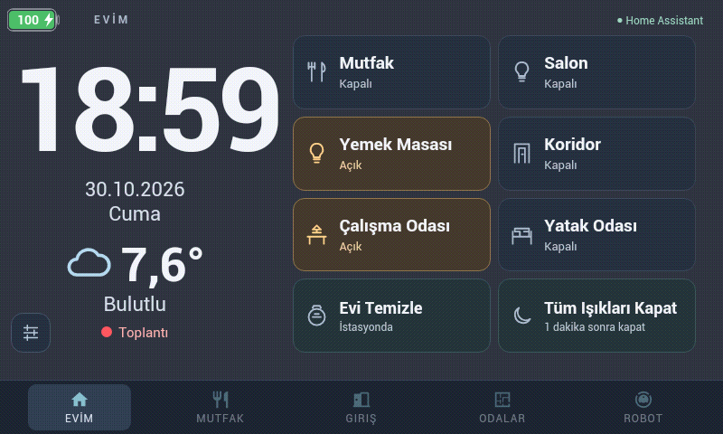

# Optional Mac Teams call indicator

The companion [Mac Call Indicator](https://github.com/kilinccagatay/mac-call-indicator)
runs on macOS 13 or later and reports a single boolean to Home Assistant. The
tablet remains a HoaryDash display. The full helper source, permission notes,
build instructions, login setting, and limitations are maintained in its own
repository.

## Set up the receiver and Mac

1. Follow the companion's README and merge its
   [`examples/home-assistant.yaml`](https://github.com/kilinccagatay/mac-call-indicator/blob/main/examples/home-assistant.yaml)
   into your existing `template:` list. Preserve other template entities.
2. Put your own randomly generated webhook ID in Home Assistant's private
   `secrets.yaml`. Never commit the real ID or webhook URL.
3. Validate Home Assistant's configuration and reload templates. The resulting
   entity is `binary_sensor.mac_call_active`; it expires after 40 seconds without
   reports and initializes off after Home Assistant starts.
4. Build/install the Mac app, configure its private webhook URL file, and grant
   Accessibility through normal macOS settings only if your workplace allows it.
5. Use the Mac menu's **Start at Login** checkbox if desired. It can be turned
   off without stopping the current app. No microphone, camera, screen recording,
   Apple Events, Graph, or Entra access is required by the helper.

The Mac menu also supports **Meeting until…**, **30 min meeting**, and
**1 hour meeting** for an intentional manual meeting. The Mac computes remaining
minutes from its local clock and shows the countdown in its menu bar. End times
and durations remain local; Home Assistant still receives only a boolean. A
Teams call starting or ending does not alter that manual deadline. The tablet
badge stays on while either the manual timer or an actual detected call is active.

Keep the receiver on a trusted private network. Prefer HTTPS where available;
HTTP traffic is not encrypted. Do not expose the webhook or HoaryDash publicly.

## Add the Home badge

The full [`hoarydash.example.yaml`](../examples/hoarydash.example.yaml) already
contains the optional card and script. For an existing dashboard instead:

1. Add `binary_sensor.mac_call_active` to Ana's `sensors.cards`, with an empty
   label and `icon: circle`. This makes HoaryDash subscribe to the entity.
2. Append [`hoarydash-call-badge.html`](../examples/hoarydash-call-badge.html) to
   the existing `theme.custom` string. It uses the same style/script injection
   convention as the dashboard example; do not replace your existing CSS.
3. Preserve the `last_report_epoch` attribute from the receiver template. It
   lets the browser reject a stale true state even if connectivity is lost.
4. Restart HoaryDash and reload the panel. An old Crosswalk HTTP cache may keep
   the previous page even after an app restart. Use a cache-clearing refresh
   before diagnosing the badge as broken. Keep periodic Browser Refresh off.

The original dashboard example places the badge in a 62-pixel-wide block, 12 pixels from the right and 14 pixels from
the bottom of Ana. A 14-pixel red dot sits above the centered **Toplantı** label.
This clears the existing navigation on the tested 800 × 480 panel. It does not
move the clock, weather, lights, or navigation. Other screen names/layouts may
need different selectors and offsets. Keep custom JavaScript ES5-compatible.

## Panel V2 on the physical tablet

Panel V2 includes its own meeting indicator below the weather on **Evim** (the
internal screen remains `Ana`). Do not add a second legacy overlay to Panel V2.
The image below was captured directly from the Denver tablet during an active
meeting, with the native battery badge visible. It was rotated 180° to match the
physical mounting; the screen content was not otherwise changed.

## Verification and limits

- A connected Teams test call made the badge appear on the physical Denver.
- Muting the microphone kept the indicator active; ending the call hid it.
- Repeated synthetic heartbeats kept it visible beyond the first 40 seconds.
  After reports stopped, both the browser and receiver returned to off/hidden.
- The indicator belongs only to Home; switching tabs moves it out of view.
- Updating the ad-hoc-signed Mac app invalidated its prior Accessibility record.
  Renewing that application's existing permission restored detection; no broader
  permission or policy bypass was used. See the helper's troubleshooting notes.

The detector uses Teams UI evidence, not Busy presence. Current validation is
for Teams desktop test calls with English controls, not every Teams version,
language, work meeting, lock-screen state, or Phone/FaceTime call. Validate your
own setup and treat missing/unreadable state as hidden.
