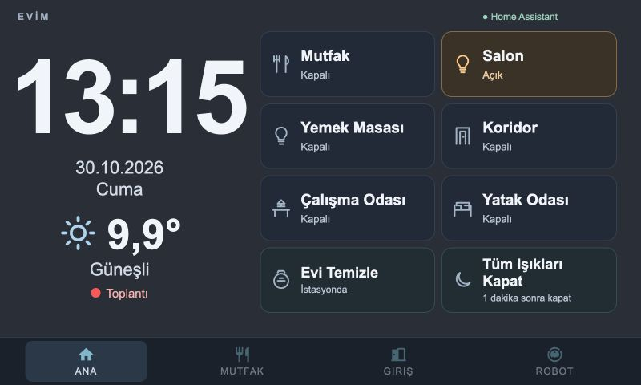
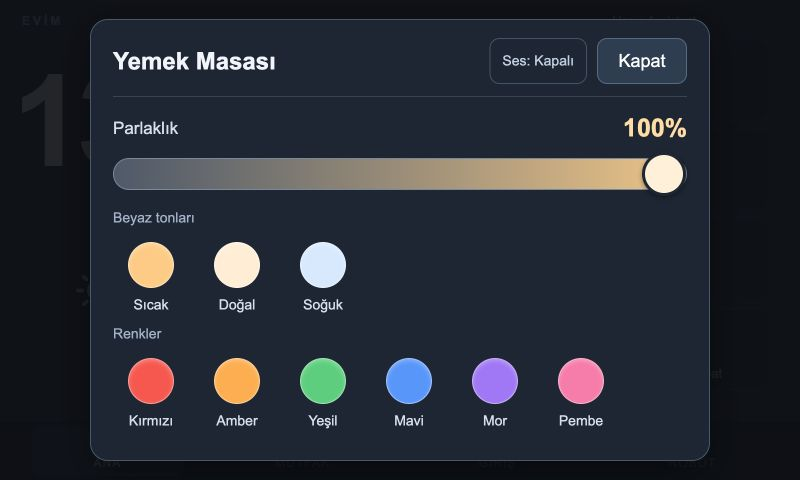

# Panel V2: touch controls on older hardware

Panel V2 is an optional ES5/CSS overlay on the existing HoaryDash dashboard.
It preserves WallPanel's native battery badge (including its long press), camera,
backlight profile, watchdog, and power-key behavior. No APK/firmware update is needed.

## Screenshots

These are 800 × 480 browser captures of the deployed dashboard with live HA data,
not screenshots taken from the tablet. The battery badge is a native WallPanel
overlay and is therefore absent in a desktop browser.





## Home

The left column has a large clock, two-line Turkish date, larger weather and an
optional fresh meeting indicator. The right column has eight controls, in this row order:

| Left | Right |
| --- | --- |
| Kitchen | Living room |
| Dining table | Corridor |
| Office | Bedroom |
| Robot | All lights off |

Their behaviors are:

- Living room and dining table: tap to toggle; hold 650 ms for settings.
- Corridor: turn both corridor lights off if either is on, otherwise both on.
  Hold to adjust the two lights individually.
- Bedroom and office: tap to toggle; hold for settings.
- Kitchen: toggle **counter and sink only**, excluding the dining table. If either
  light is on, turn both off; otherwise turn both on. Hold for individual settings.
- Robot: **Evi Temizle** when idle, **Temizliği Durdur** when cleaning (returns to
  base, including when paused). While returning, another start is not offered. Unavailable/error states do not offer actions.
- All lights off: schedule a 60-second shutdown; tap again to cancel. The countdown
  is displayed only on this Home button; there is no duplicate banner.

The settings dialog only offers the capabilities the entity supports: brightness,
three white-temperature presets within the device limits, and six large circular RGB presets.
The brightness control has a large thumb and percentage readout. An optional
**Ses: Kapalı / Açık** button in the dialog enables a quiet synthesized click; the
preference is saved in this browser only, defaults off, and requires no audio files
or microphone permission. Unsupported audio browsers remain silent.
Touch focus rings clear when the dialog closes; keyboard Tab focus stays visible.
The Home Assistant label at the top indicates the connection to HA.
Sliders send a command on release/change, not on every movement. There are no
chevrons under light buttons; long presses do not also toggle. A dragged/canceled
touch does not act. Other tabs keep their existing layouts, using the same light
cards and modal. Set `removedScreens` to a list of exact screen names in the private
mapping to remove unwanted tabs, including their swipe destinations. The installer
backs up their original definitions; `Ana` cannot be removed.

The UI distinguishes unavailable devices and disconnected transport from "off".
Pending actions keep their labels and state text stable, dim only the icon, and
prevent duplicate taps until acknowledged. Failures still show a notice.
A small pre-render gate hides the legacy screen until the overlay is ready, avoiding
a flash of the old Home layout. An eight-second fallback releases it if initialization
fails, so a JavaScript failure does not leave a permanent loading screen.
No blur, continuous animation, framework, or extra state polling is introduced.
Weather changes merge attributes; missing temperature is never replaced with zero.
On connection/reconnection, a one-time targeted REST reconciliation avoids stale
initial data from HoaryDash's warming pool. At most two requests run together,
and WebSocket changes received while a request is in flight take precedence.

## Install

1. Back up the current HoaryDash configuration and use a matching known-good APK
   and root helper profile. Do not change native battery/brightness settings.
2. Copy `examples/panel-v2/config.example.json` to a **private** mapping file. Replace
   every example entity. Give the lights helpful labels. Include every displayed
   light in `allLights` or `extraLights`; `extraLights` are not shutdown targets.
3. Install `examples/panel-v2/lights-off-script.example.yaml` in Home Assistant and
   reload scripts. Set `countdown` in the mapping to that script entity. The script
   and mapping must use the **same explicit household light list**. Exclude power
   switches, smart-plug indicators, printer illumination, and server devices.
4. On the HoaryDash host, with Python 3 and PyYAML available, run:

   ```sh
   python3 tools/install-panel-v2.py \
     --hoarydash /path/to/hoarydash.yaml \
     --mapping /private/path/panel-mapping.json \
     --assets examples/panel-v2 \
     --backup-dir /private/path/panel-backups
   ```

5. HoaryDash regenerates the dashboard and asks connected browsers to reload.
   Restart the HoaryDash add-on once when adding new entity subscriptions; the
   tested 0.13.0 proxy retains its startup subscription list until restart.
   Verify Home, every tab, dialogs, unavailable states, and timeout/motion wake on
   the actual tablet. The install preserves original screens and adds the entity
   subscriptions it requires. Re-running updates the injected overlay once.

Private mappings, complete live configurations, tokens, and backups do not belong
in Git. Assets and sanitized examples here have no credentials or private hosts.
Rollback by restoring the saved YAML. Do not mix two independently implemented
countdown scripts with the same UI mapping.

## Countdown behavior

The running **HA script**, rather than a browser timer, owns the delay. Its on/off
state and `last_triggered` time let a refreshed/reconnected panel reconstruct the
remaining time. `script.turn_off` cancels the waiting script. At expiry the script
selects only currently-on lights from its explicit allowlist; an empty selection
never invokes a broad turn-off action. Lights switched on during the countdown
are included if they belong to that list.

A full Home Assistant restart or script reload stops a waiting script; the UI
then clears its countdown. This is a short exit delay, not a persistent schedule.
Cancellation cannot undo a turn-off service already dispatched at expiry.

## Tests

Run `node tests/panel-v2.test.cjs` for compact state merging, device capabilities,
group behavior, robot state transitions, countdown timing, and touch/long-press
separation. Also run `node tests/weather-state.test.cjs` for weather regression.
The old-browser syntax should be parsed as ES5 before deploying changed assets.

For the countdown's actual HA script engine tests, use an isolated Python 3.13
environment with `tests/requirements-panel-ha.txt`, then run
`python tests/countdown-ha.test.py`. These four tests exercise allowlisted/currently
on targets, empty-selection safety, lights turned on during the delay, and
cancellation. They shorten only the delay and register a local recording service;
no physical devices or network calls are used.

## Tablet remains on the old layout

The tested HoaryDash 0.13.0 proxy uses a shared reload channel; a rebuild notification
can be consumed by another open dashboard connection instead of the tablet.
A normal reboot also does not guarantee that the tablet fetches a fresh document.
Do not erase WallPanel settings or reinstall the APK to solve this.

The verified recovery is to temporarily navigate other dashboard browsers away,
restart only the HoaryDash add-on to discard old connection handlers, let the
tablet reconnect, then save a harmless YAML comment to request a rebuild/reload.
Confirm the new layout on the physical tablet before reopening test dashboards.
Home Assistant and native WallPanel helpers do not need to be restarted or changed.
